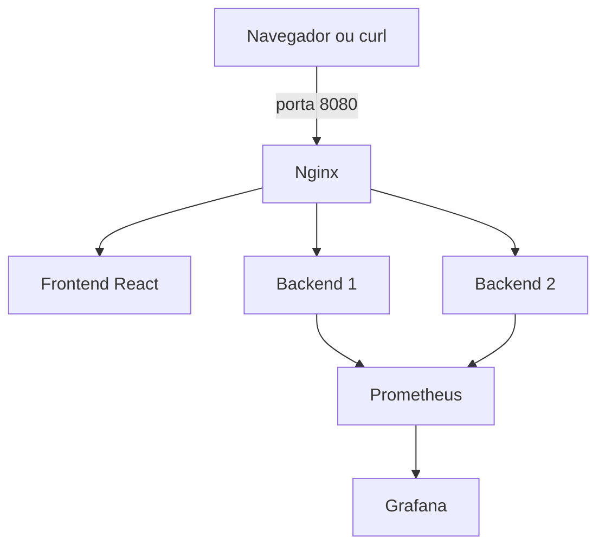

# CourseSphere Security Hardening

Avaliação prática de AppSec, SRE e DevOps realizada sobre o [CourseSphere](https://github.com/LambdaAK/CourseSphere). O projeto documenta cinco vulnerabilidades reais, corrige a causa raiz de quatro delas e adiciona hardening, testes, observabilidade, containers e balanceamento entre duas instâncias da API.

## Resultado

- 5 vulnerabilidades confirmadas em 4 categorias;
- 4 comportamentos vulneráveis corrigidos;
- 10 testes automatizados de segurança e observabilidade;
- logs JSON com `request_id` e identificação da instância;
- endpoints `/health` e `/metrics` compatíveis com Prometheus;
- Nginx na frente de 2 backends;
- dashboard Grafana provisionado automaticamente;
- SAST, SCA, build de containers e detecção de segredos no CI.

O [relatório técnico](docs/SECURITY_REPORT.md) contém severidade, impacto, causa raiz, passos de reprodução, evidências sanitizadas e recomendações priorizadas.

## Arquitetura local



## Início rápido com Docker

Pré-requisitos: Docker Engine com Docker Compose v2.

```bash
git clone https://github.com/Cassio327/coursesphere-security-hardening.git
cd coursesphere-security-hardening
docker compose up --build -d
```

Ou:

```bash
make up
```

Serviços disponíveis:

| Serviço | Endereço |
|---|---|
| Aplicação | http://localhost:8080 |
| Health via balanceador | http://localhost:8080/api/health |
| Métricas via balanceador | http://localhost:8080/api/metrics |
| Prometheus | http://localhost:9090 |
| Grafana | http://localhost:3000 |

O Grafana local usa `admin` / `local-observability-only`. Essa senha existe apenas para demonstração local e deve ser substituída em qualquer ambiente compartilhado.

Para acompanhar os logs:

```bash
make logs
```

Para encerrar:

```bash
make down
```

## Demonstrar o balanceamento

Com os containers ativos:

```bash
make load-balance
```

O script faz oito requisições e imprime o campo `instance`. O resultado deve conter respostas de `backend-1` e `backend-2`:

```text
1: {"instance":"backend-1",...}
2: {"instance":"backend-2",...}
```

Os logs JSON do Nginx também exibem `upstream`, permitindo identificar qual container respondeu.

## Executar testes

### Backend

```bash
python3 -m venv .venv
source .venv/bin/activate
pip install -r backend/requirements-dev.txt
pytest -q backend/tests
```

### Frontend

```bash
cd frontend
npm ci
npm run lint
npm run build
```

### Verificação rápida da versão corrigida

```bash
make smoke
```

Esse script confirma que `/users/query` rejeita acesso anônimo e que os headers de segurança estão presentes.

## Executar as ferramentas de segurança

Depois de instalar as dependências de desenvolvimento:

```bash
make security
```

Comandos individuais:

```bash
bandit -q -r backend -x backend/tests
pip-audit -r backend/requirements.txt
cd frontend && npm audit --audit-level=high
```

O CI também executa testes, Bandit, `pip-audit`, auditoria npm, Gitleaks, validação do Compose e build das imagens. Resultados locais registrados: [docs/TOOL_RESULTS.md](docs/TOOL_RESULTS.md).

## Reproduzir os achados com segurança

Não use credenciais do projeto original e não aponte os testes para serviços externos. As evidências já coletadas estão em [`docs/evidence`](docs/evidence).

Para inspecionar o comportamento anterior às correções sem alterar a branch atual:

```bash
git worktree add ../coursesphere-baseline f0765ae1f97a48d19f25b37debc033fe4bd5160f
python3 -m venv ../coursesphere-baseline/.venv
../coursesphere-baseline/.venv/bin/pip install -r ../coursesphere-baseline/backend/requirements.txt
```

Exemplo seguro para confirmar a ausência de autenticação na baseline:

```bash
cd ../coursesphere-baseline/backend
../.venv/bin/python -c "from endpoints import app; c=app.test_client(); r=c.post('/users/query', json={'query':'local test'}); print(r.status_code, r.get_json())"
```

Resultado histórico esperado: HTTP 200 sem Bearer token. Na versão corrigida, o teste equivalente retorna HTTP 401.

Para reproduzir cada achado, siga os documentos:

- [VULN-01 — credencial no código-fonte](docs/evidence/VULN-01-secret-in-source.md)
- [VULN-02 — token na URL](docs/evidence/VULN-02-token-in-url.md)
- [VULN-03 — CORS permissivo](docs/evidence/VULN-03-permissive-cors.md)
- [VULN-04 — exposição de erro](docs/evidence/VULN-04-error-disclosure.md)
- [VULN-05 — consulta sem autenticação](docs/evidence/VULN-05-missing-authentication.md)

Remova o worktree após a análise:

```bash
cd ../coursesphere-security-hardening
git worktree remove ../coursesphere-baseline
```

## Configuração de integrações

O backend inicia sem acessar Firebase ou OpenAI. Para utilizar essas integrações em ambiente autorizado, configure os valores descritos em [`backend/.env.example`](backend/.env.example). O frontend usa [`frontend/.env.example`](frontend/.env.example).

Nunca envie `.env`, tokens ou arquivos de credenciais ao repositório. Em produção, use um secret manager.

## Estrutura principal

```text
backend/                 API, segurança, métricas e testes
frontend/                aplicação React e imagem web
infrastructure/          Nginx, Prometheus e Grafana
scripts/                 demonstrações reproduzíveis
docs/evidence/           evidências antes e depois
docs/SECURITY_REPORT.md  relatório de AppSec e confiabilidade
docs/OBSERVABILITY.md    SLIs, SLOs, dashboard e riscos
docs/THREAT_MODEL.md     fluxo de dados e STRIDE
```

## Limitações

- integrações externas não são testadas sem credenciais próprias;
- o gerenciador de consultas do projeto de referência ainda devolve uma resposta simulada;
- o banco de cursos original não está incluído;
- o rate limiter em memória deve ser substituído por Redis ou gateway em produção;
- TLS deve ser configurado no ambiente real antes de ativar HSTS.

## Origem e autoria das alterações

- Aplicação de referência: [LambdaAK/CourseSphere](https://github.com/LambdaAK/CourseSphere)
- Commit analisado: `71616a08b8756f048d5bf237be433c3b996a43d1`
- Segurança, confiabilidade, infraestrutura, testes e documentação: desenvolvimento realizado para o desafio técnico do V-LAB.
