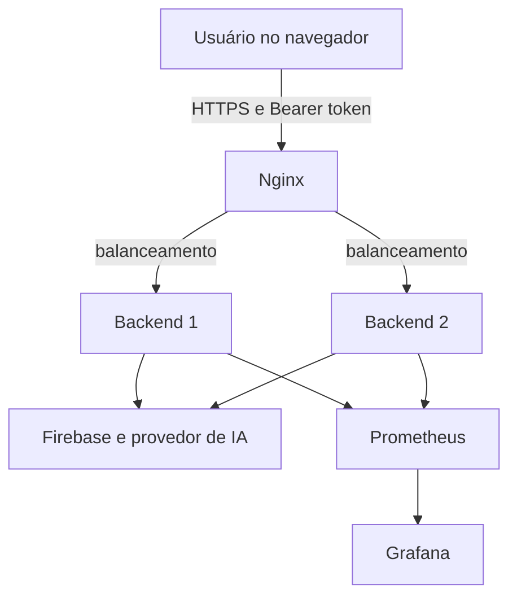

# Threat model resumido

## Ativos principais

- tokens de identidade Firebase;
- perfis e históricos de conversa;
- credenciais de integrações externas;
- cotas e custos do provedor de IA;
- disponibilidade da API.

## Fluxo de dados

As fronteiras de confiança estão entre navegador e Nginx, Nginx e backends, e backends e provedores externos. No ambiente local o tráfego é HTTP; uma implantação real deve terminar TLS no ponto de entrada.

## STRIDE

| Ameaça | Exemplo no sistema | Controle atual | Evolução recomendada |
|---|---|---|---|
| Spoofing | token ausente, falso ou roubado | verificação Firebase e Bearer obrigatório | revogação e detecção de anomalias |
| Tampering | alteração de perfil de outro usuário | `uid` extraído do token, não do corpo | testes de autorização por recurso |
| Repudiation | usuário nega uma consulta | request ID, instância e evento de autenticação | trilha de auditoria com retenção |
| Information disclosure | token na URL e detalhes de exceção | header Authorization e erros genéricos | redaction centralizada de logs |
| Denial of service | criação automatizada de contas | limite de payload e rate limiting | Redis, WAF e limites no gateway |
| Elevation of privilege | processo comprometido obtém privilégios do host | container sem root e capabilities removidas | perfil seccomp e filesystem mínimo |

## Decisões de desenho

- O backend nunca confia em `uid` enviado pelo cliente.
- Tokens não são gravados em logs ou respostas.
- Integrações externas são inicializadas somente quando configuradas.
- Métricas não incluem dados pessoais nem conteúdo de consultas.
- Segredos devem entrar por serviço de gestão de segredos, não por imagem ou repositório.
